<p align="center">
  
</p>

<p align="center">
  <a href="https://github.com/VPNmAsteRR?tab=overview">
    
  </a>
</p>

<p align="center">
  <a href="https://github.com/VPNmAsteRR?tab=overview"></a>
  <a href="https://github.com/VPNmAsteRR?tab=overview"></a>
</p>

<p align="center">
  <a href="https://github.com/VPNmAsteRR/time-clicker"></a>
  <a href="https://github.com/VPNmAsteRR/TeleGBot"></a>
</p>

```console
$ cat about.txt
```

```
python-dev. Собираю ботов, веб-сервисы и игры — от идеи до работы на сервере.
Люблю, когда код не просто компилируется, а приносит пользу.
```

```console
$ tree ~/projects -L 1
```

```
projects/
├── tele-gbot/          Telegram-бот на Python — в работе
├── time-clicker/       кликер на чистом HTML/JS
├── vegaai/             AI-бот на GigaChat · Python + Rust
├── bot-vizitka/        услуги, запись, заявки, админка
├── vozduhan/           мини-игра для Яндекс Игр · 15 уровней
├── osm-clients/        поиск клиентов по OSM + Wikidata
├── destok-vpn/         сайт, кабинет, бот, Mini App
└── qwen-lora/          LoRA-дообучение локальной модели
```

```console
$ cat boot.log
```

```
[  OK  ] Mounted /dev/brain
[  OK  ] Started Python Interpreter (aiogram 3)
[  OK  ] Started Node.js Service
[  OK  ] Started Rust Compiler (may take a while)
[ WARN  ] Coffee level low — refill recommended
[  OK  ] Reached target Ship It
```

```console
$ htop --skills
```

```
  PID  USER        CPU%   MEM%   COMMAND
 1024  ametistovv  42.0   18.0   python bot.py --aiogram
 2048  ametistovv  31.5   12.0   node server.js --sqlite
 3072  ametistovv  12.8    9.0   cargo run --release
 4096  ametistovv   8.2    6.0   nano README.md
 5120  ametistovv   0.4    1.0   coffee --refill
```

```console
$ cat stack.txt
```

```
  Python        ████████████████████░  90%
  JavaScript    ████████████████░░░░░  75%
  Node.js       ███████████████░░░░░░  70%
  Linux / VPS   █████████████████░░░░  80%
  SQL / SQLite  █████████████░░░░░░░░  65%
  Rust          ████████░░░░░░░░░░░░░  40%
```

```console
$ git log --oneline --graph
```

```
* 3f2a1c9  feat: запустил бота, который не падает по ночам
* 8e1d4b7  fix: оказалось, это был не баг, а фича
* c9b0e21  refactor: переписал начисто в третий раз
* 1a7d5f3  docs: добавил README, который ты сейчас читаешь
* 0b3c8d1  init: hello, world
```

```console
$ cat contacts.txt
```

```
  github   github.com/VPNmAsteRR
  telegram скоро здесь
  status   открыт к интересным задачам
```

<p align="center">
  <picture>
    <source media="(prefers-color-scheme: dark)" srcset="https://raw.githubusercontent.com/VPNmAsteRR/VPNmAsteRR/output/snake-dark.svg" />
    <source media="(prefers-color-scheme: light)" srcset="https://raw.githubusercontent.com/VPNmAsteRR/VPNmAsteRR/output/snake.svg" />
    
  </picture>
</p>

```console
$ exit
logout
Connection to github.com closed.
```

<p align="center">
  <sub><code>ametistovv</code> · Python · JavaScript · Rust · Linux · <a href="https://github.com/VPNmAsteRR?tab=repositories">весь код →</a></sub>
</p>
